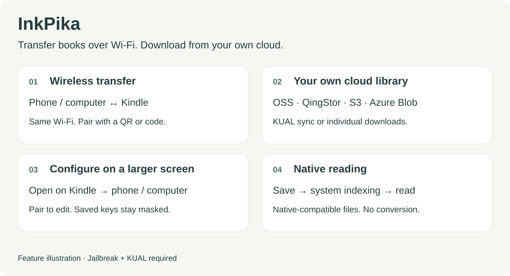
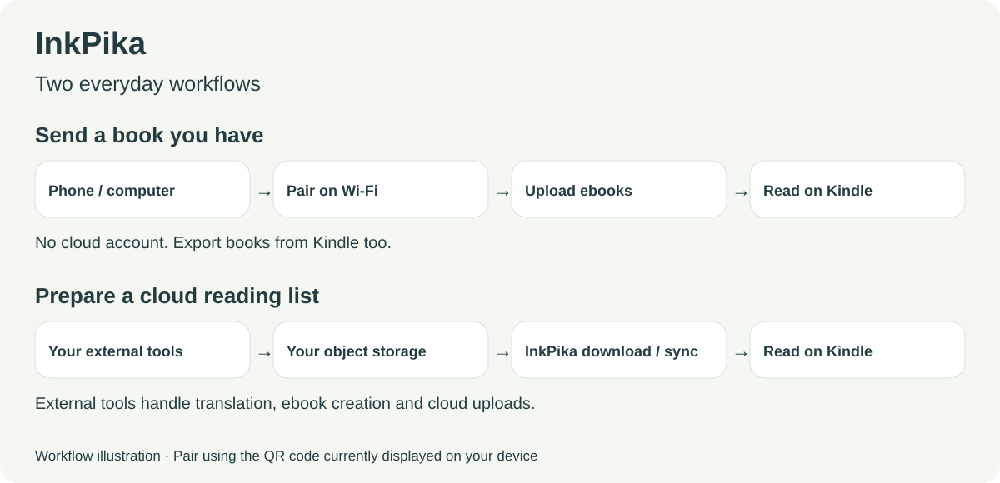

# InkPika

**English** · [简体中文](README_ZH.md)

[Project overview](https://mr-jimmy6.github.io/inkpika/) · [Interactive demo](https://mr-jimmy6.github.io/inkpika/preview/index.html)

> **Languages:** English and Chinese. The device interface and all shared web pages follow the Kindle system language by default; unsupported or unavailable locales fall back to English. Set `language` to `en` or `zh` to override it, or `auto` to follow Kindle. Visitor browser language is ignored. The public website and this README default to English.

Transfer books over Wi-Fi. Download from your own cloud.

Transfer books between your phone, computer and Kindle over Wi-Fi, or download ebooks from your own object storage and open them in the native Kindle reader.

InkPika is intended for Kindle users across generations. Installation requires jailbreak and KUAL. Device requirements and adaptation notes are in the [compatibility guide](docs/DEVICE_COMPATIBILITY.md); feature and device test results are in the [validation record](docs/DEVICE_VALIDATION.md).



> **In development · 0.0.1.dev** — [Build the package](README_DEV.md#构建与检查). Package: `inkpika-0.0.1.dev-armv5.zip` and its `.zip.sha256`. Configuration pages show the version and UTC package time.

[Best practices](#best-practices) · [Compare transfer methods](#compare-transfer-methods) · [Installation](#installation) · [Wireless transfer](#wireless-transfer) · [Cloud configuration](#configure-from-your-phone-or-computer) · [Troubleshooting](#troubleshooting) · [Developer guide](README_DEV.md)

This guide uses the English interface labels. A complete [Chinese guide](README_ZH.md) is also available. Supporting technical documentation is primarily in Chinese.

## Best practices

- **Send books directly from your phone:** Connect your phone and Kindle to the same Wi-Fi, open Wireless Transfer on the Kindle, then scan to pair and upload books from your phone. Everyday transfers need no PC, cloud account, or extra phone transfer app. Open compatible files in the native reader after they are saved and indexed.
- **Translate a paper, then sync it from the cloud:** Use your own Hermes or similar agent to translate an English paper, create a Kindle-readable ebook, and upload it to your object storage's `sync/` directory. Select Start Sync on the Kindle to download it for local reading.



The illustrations show example workflows. The actual transfer entry is **KUAL → InkPika → Wireless transfer [web]**; pair using the QR code currently displayed on your device. Set up Feishu, Hermes, or a similar agent yourself for the paper workflow. These external tools handle translation, ebook creation, and upload; InkPika checks and downloads the cloud books.

## Compare transfer methods

This table compares everyday transfers after the tools are installed. Local transfer suits books already on your phone; a cloud library suits a maintained reading list and files prepared by your own tools.

| Criterion | InkPika: local transfer | InkPika: cloud library | Calibre | KOReader transfer | Amazon Send to Kindle |
| --- | --- | --- | --- | --- | --- |
| PC required? | No; a phone browser is enough | No, once books are uploaded | Usually a computer or a device running the Content server | Depends on the transfer channel | No; a phone can be used |
| Device and service requirements | Jailbroken Kindle + KUAL | Jailbroken Kindle + KUAL; your own object storage | No Kindle jailbreak; Calibre on a computer or server | Jailbroken Kindle with KOReader installed | No Kindle jailbreak; an Amazon account eligible for the service |
| Pairing and configuration | Scan to pair on your phone | Scan to enter cloud settings on your phone | USB connection, or configure the Content server or another wireless method | Configure the server address or cloud account for the chosen channel | Sign in through the website or app; email delivery requires an approved sender address |
| Everyday controls | Phone browser; open the transfer entry on Kindle | Configure on a phone; sync or select books on Kindle | Mainly the desktop client, or a browser accessing the Content server | Mainly the KOReader interface on Kindle | Phone app, website, or email |
| Native Kindle reading | Yes, for compatible files in the system library | Yes, for compatible files in the system library | Yes; transfer a format the native reader supports | Usually read in KOReader; native-compatible files saved to the system library can also use the native reader | Yes; the service processes supported document formats |
| Main strengths | QR pairing and transfers in both directions, without a cloud account or phone app | Your own cloud library, phone configuration, batch sync checks and downloads, or individual book selection | Library management, batch organization, and format conversion | Multiple transfer channels and support for reading many formats | No jailbreak, convenient delivery, and reading on linked devices |
| Main limitations | Same local network required; no format conversion | Your own supported object storage; sync is triggered manually; no format conversion | Requires a computer or server; wireless methods need configuration | Requires KOReader and setup for the selected transfer method | Depends on Amazon's service, format and size limits, and service availability |

See the [device compatibility document](docs/DEVICE_COMPATIBILITY.md) for InkPika support. Native reading depends on the device's supported formats. For third-party methods, consult their current documentation and service availability for your account's region: [Calibre Content server](https://manual.calibre-ebook.com/server.html) · [KOReader user guide](https://koreader.rocks/user_guide/) · [Send to Kindle](https://www.amazon.com/sendtokindle).

## Features

- **Native reading:** Once books are saved locally and indexed by the system, open them in the familiar native Kindle reader.
- **Wireless transfers in both directions:** Pair by scanning a QR code on your phone or entering a code in a computer browser. Upload books in batches, or search and download books from the Kindle. No cloud account is needed.
- **Two ways to download from the cloud:** Start a sync in KUAL to automatically check and download missing or updated books under `sync/`, or browse the graphical bookshelf and download selected books. Sync starts when you click; it is not a scheduled task.
- **Multiple cloud providers and ways to add books:** Use Alibaba Cloud OSS, QingStor, Azure Blob, or S3-compatible object storage on a public cloud or NAS, with optional SOCKS5 proxy support. Upload books to your own cloud library through the provider's management interface, an agent with the appropriate tools and authorization, or an API, then read them from Kindle.
- **Configure by QR code:** Open Configuration on Kindle, then scan with your phone to enter credentials, folders, and format settings without typing on the Kindle screen. A computer browser works too.

| What you want to do | Entry point | What it does |
| --- | --- | --- |
| Send books to your Kindle or retrieve local books | Wireless transfer [web] | QR or browser code pairing, batch uploads, search, and downloads; multiple books are exported as a ZIP |
| Choose books from your cloud library on Kindle | Cloud library [web] | Browse folders within the configured scope, download selected books, and check progress and local file status |
| Sync a cloud reading list to Kindle | Start sync | Check `sync/` from KUAL and download missing or updated books |
| Enter cloud credentials and settings on a larger screen | Settings [web] | Scan with your phone or pair from a computer to edit settings; stored credentials are masked |

Uploads to your cloud library are handled by the cloud provider or its tools. InkPika only lists and reads cloud objects; it does not upload or delete remote objects. Wireless uploads save files locally on your Kindle.

## Compatibility and limitations

Installation requires a jailbroken Kindle with KUAL and a compatible Mesquite/WAF environment. The Linux ARMv5 build uses the Japanese PW2, firmware **5.12.2.2** and Linux 3.0.35, as its engineering baseline. Model-specific requirements and limitations are maintained in the [device compatibility guide](docs/DEVICE_COMPATIBILITY.md); checks and results are maintained in the [validation record](docs/DEVICE_VALIDATION.md).

The default allowed formats are **AZW, AZW3, MOBI, PRC, PDF, and TXT**. You can change this list in the configuration. Formats are checked by filename extension. The project does not convert files, handle DRM, or provide a reader. The PW2's built-in reader cannot open EPUB directly; you can convert it to AZW3 with Calibre first.

No Python, Node.js, or additional language runtime is needed on the Kindle. Jailbreaking and installing KUAL or an SSH plugin are outside this project's installation process. See the [device validation record](docs/DEVICE_VALIDATION.md) for testing scope and limitations.

## Installation

You can copy the files manually over USB or use a coding agent on your computer to install them over SSH. Both methods require a jailbroken Kindle with KUAL installed. Check the [compatibility document](docs/DEVICE_COMPATIBILITY.md) first. The instructions below use the Linux ARMv5 package and do not establish verified support for other models.

### Option 1: Copy over USB

1. Obtain `inkpika-0.0.1.dev-armv5.zip` and its `.zip.sha256` from a [local build](README_DEV.md#构建与检查), verify the checksum, and extract it on your computer.
2. Connect your Kindle over USB. Copy the package's `extensions/inkpika` folder into the Kindle USB drive's `extensions/` directory. The final path on the device must be `/mnt/us/extensions/inkpika/`; keep the directory name and avoid adding an extra directory level.
3. Safely eject the USB drive and connect the Kindle to Wi-Fi.
4. Open **KUAL → InkPika**. Try **Wireless transfer [web]** first; no cloud configuration is needed.
5. To use the cloud bookshelf or KUAL sync, set up your storage account through **Settings [web]**.

### Option 2: Install with a coding agent

Prerequisites:

- **Agent software:** Install a tool such as Codex, Qoder, or Workbuddy that can read project files and run local commands on your computer.
- **SSH key authentication:** Your computer must be able to log in to the Kindle without an interactive password prompt. **USBNetwork Hack** can provide the SSH server; configure public-key authentication as described in the [developer guide](README_DEV.md#用-usbnetwork-hack-配置-ssh-密钥登录). Keep the private key on your computer.

Obtain and extract the [0.0.1.dev installation package](README_DEV.md#构建与检查), then open the extracted directory in your agent. Keep the Kindle reachable and awake, and unlock it on the device when checking the interface. Developers who want to build from source can follow the [build instructions](README_DEV.md#构建与检查).

Give the agent the following prompt, replacing the SSH alias with your own:

```text
Install InkPika on my Kindle using README.md.
Device SSH alias: kindle-dev (replace with my actual alias; key authentication is configured).

Read AGENTS.md, README_DEV.md, and docs/DEVICE_COMPATIBILITY.md first.
Verify SSH access and check the device model, firmware, and corresponding compatibility status.
Use the executable in inkpika-0.0.1.dev-armv5.zip; no source build is needed for installation.
Install the package's extensions/inkpika/ directory over SSH at
/mnt/us/extensions/inkpika/, preserving executable permissions.
Check the target directory and running services before installation; stop this project's services if needed.
Back up and preserve existing settings, books, and download and sync records.
Do not overwrite personal configuration with example files.
Check that the installed files match the package, and verify the KUAL menu and Wireless Transfer entry.
Tell me when an action on the device screen is needed. Report the installation result and what was actually verified.
```

After installation, open **KUAL → InkPika**. Wireless transfer does not require a cloud account. Configure storage through **Settings [web]** when you want to use cloud features.

Entries marked `[web]` open a dedicated web window on the Kindle. Wireless Transfer and Configuration show connection instructions; Cloud Bookshelf is used directly on the Kindle. Open these entries from KUAL; the standard Kindle browser cannot replace them.

## Wireless transfer

1. Connect your Kindle and phone or computer to the same Wi-Fi network. Open **KUAL → InkPika → Wireless transfer [web]**.
2. The Kindle displays the current Wi-Fi name, IP address, access URL, QR code, and six-digit pairing code. On a phone, scan the QR code and open it in a browser. On a computer, enter the displayed URL and pairing code.
3. Use **Send to Kindle** to select and upload files in batches. Use **Download from Kindle** to search by filename, select books, and download them.

Each batch supports up to 50 books. The download list covers the Kindle's local book directory and only includes allowed formats. A single book is downloaded as the original file; multiple books are bundled into a ZIP. Allowed formats are shown before uploading. If a filename already exists, the new file is saved with a numeric suffix, preserving the existing book.

The default wireless upload directory is `/mnt/us/documents/InkPika/Wireless`. Files are saved only after reception completes, then indexed by the Kindle system. Wireless uploads are not counted in the cloud sync list.

Keep the Kindle awake during transfers. Wireless Transfer and Configuration use HTTP on the local network; use them on trusted Wi-Fi. Pairing codes do not encrypt traffic. You need to pair again after restarting a service.

## Configure from your phone or computer

Open **KUAL → InkPika → Settings [web]** to view saved settings, masked credentials, build details and the connection test on Kindle. Select **Phone / computer** for the pairing URL and QR code, then edit settings in that browser.

Choose your storage platform and enter its bucket, region and access keys. Stored keys are masked; leave a key field blank to preserve it. Saving validates the configuration and safely restarts a running cloud service.

For provider instructions, read-only permissions, NAS, SOCKS5, certificates and cost estimates, see the [object storage guide](docs/OBJECT_STORAGE.md).

### Allowed ebook formats

Enter extensions separated by commas or spaces, such as `azw3, pdf, txt`. Leave the field blank to use the built-in defaults. In a manually edited configuration, this is the `ebook_formats` array.

The same rule applies to upload validation, local book download lists, Cloud Bookshelf, and KUAL sync. Allowing a format for transfer does not add support for that format to the Kindle's built-in reader.

## Cloud bookshelf

Open **KUAL → InkPika → Cloud library [web]** to browse folders and download books manually. By default, it browses the entire bucket. If a `prefix` is configured, browsing is limited to that scope. The bookshelf is not restricted to `sync/`.

The list shows the original filename, format, size, remote modification time, and a downloaded indicator. The download list shows only the original cloud filename by default. Expand **Details / 详情** to see the **Actual saved filename / 实际保存名**; its identifier distinguishes files with the same name.

| Download list status | Meaning |
| --- | --- |
| Transfer complete | File content has finished transferring; check the local status to confirm it was saved |
| Saved to Kindle | The corresponding local file exists and its size matches; the system library may still be indexing it |
| Local file removed | The local file associated with the record no longer exists and can be downloaded again |

Local status is checked again when you open the download list or refresh progress. A file's presence does not prove that it matches a later cloud version. Use KUAL sync when you need version and content verification.

## Sync directly from KUAL

1. Place ebooks under **`sync/`** at the bucket root. Subdirectories are supported.
2. Select **Start sync** in **KUAL → InkPika**. The program checks remote metadata and local copies, then downloads missing files or files that need updating.
3. Open **All books** to see the remote list and use KUAL's native arrows to turn pages. Use **View status → Refresh status** to check counts and results.

Sync starts when you select the action; it is not scheduled. It only processes `sync/`. Leave `prefix` empty or set it to `sync/` when using this feature. Books are sorted by remote modification time, newest first. The downloaded count refers to books in the remote set, not the total number of files on your Kindle.

Status abbreviations: `OK` downloaded and verified, `NEW` not downloaded, `UPD` needs updating or rechecking, `ERR` failed, and `DL` downloading. After a service restart or a failed check, results are marked as **Cached**; refresh the status to check again.

Sync updates registered copies only after verification succeeds. A failed update preserves the original file, and deleting a remote object does not delete its local copy. A scan is limited to 20,000 objects and directories. See the [developer documentation](docs/DEVELOPMENT.md#下载与同步约束) for the verification rules.

Standard KUAL may return to its top-level menu after a refresh. To preserve the current menu and page, follow the [navigation patch instructions](docs/KUAL_NAVIGATION.md). The patch is separate from the client ZIP; check which KUAL version it supports before installing it.

## Background service management

**Cloud Bookshelf, Wireless Transfer, and Configuration** each have independent start and stop controls. None starts automatically at boot by default. Opening an entry starts its service as needed.

Returning to the Kindle home screen does not stop a service. When finished, open **KUAL → InkPika → Background services** to stop services you no longer need.

## Troubleshooting

| Problem | What to check |
| --- | --- |
| InkPika is missing from KUAL | Check for an extra directory level. Confirm that `menu.json` and `config.xml` are in `extensions/inkpika/`, then reopen KUAL |
| A phone or computer cannot open the transfer or configuration page | Check that both devices are on the same Wi-Fi, the Kindle is awake, and the corresponding service is running. Refresh connection information and use the current URL. Guest networks may isolate devices |
| Pairing code no longer works | Check the current code on the Kindle after a service restart, or scan the QR code again |
| Cloud access returns 401 / 403 | Run the connection test under Configuration. Check credentials, device time, bucket listing permission, and object read permission |
| HTTPS connection fails | Check Wi-Fi, region, endpoint, and device time. Keep certificate verification enabled |
| A download was interrupted | Keep the Kindle awake, check the network, and select Resume in the cloud download list. You can also start KUAL sync again |
| A book is marked as saved but missing from the home screen | Refresh the download list to check that the local file still exists. Return home, allow time for indexing, and check format and DRM compatibility. Use the actual saved filename to locate the file if needed |
| You want to clear download history | Clear finished entries removes records only; saved books are kept |

For logs, manual configuration, and SSH debugging, see the [developer guide](README_DEV.md).

## Uninstall

Run this through SSH or a local terminal on the Kindle:

```sh
sh /mnt/us/extensions/inkpika/unregister-ui.sh
```

Wait for the script to stop the services and unregister the application's window successfully, then delete `extensions/inkpika/` over USB. Saved books remain in their original directories.

## Development and contributions

See **[README_DEV.md](README_DEV.md)** for the development environment, source builds, SSH key authentication with USBNetwork Hack, and development and real-device debugging using Codex or Qoder.

Issues and pull requests are welcome; see the [contribution guide](CONTRIBUTING.md). Include the device model, firmware, storage provider, reproduction steps, and sanitized logs when reporting a problem. Keep real credentials, configuration files, session URLs, and personal books out of submissions.

[Release notes](RELEASE_NOTES.md) · [Project website source](https://github.com/mr-jimmy6/inkpika/tree/main/site)

## License

The project code and original test books are licensed under [MIT](LICENSE). Licenses for the third-party QR code library, certificate bundle, protocol test materials, and Go runtime are listed in [THIRD_PARTY.md](THIRD_PARTY.md).

## Interface language

In **Settings [web]**, choose **Follow Kindle**, **English** or **中文**. **Save language only** works before configuring cloud storage and preserves all other settings. In `config.json`, use `"language": "auto"` (default), `"en"` or `"zh"`. Auto reads `/var/local/system/locale`; missing or unsupported device locales use English. Chinese regional variants use the Chinese translation.

Cloud library, KUAL, wireless transfer and paired settings share this preference. Settings saves apply it to the running cloud service and refresh the KUAL menu; reopen or refresh other pages. After editing the file manually, restart the cloud service and refresh KUAL. Visitor `Accept-Language` and browser locale never select the device service language. The public website has an explicit English / 中文 switch and opens in English by default.

The packaged bootstrap KUAL menu is English. Starting a service or refreshing its menu regenerates it in the resolved device language.
