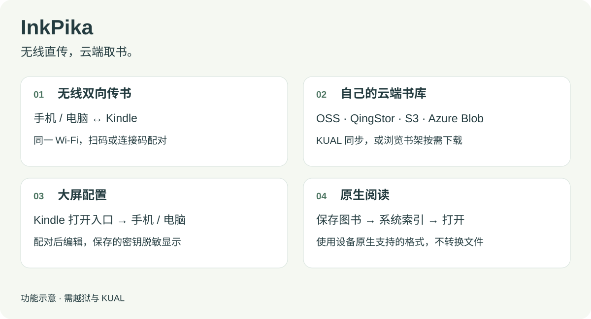

# InkPika

[English](README.md) · **简体中文**

[项目介绍](https://mr-jimmy6.github.io/inkpika/) · [体验地址](https://mr-jimmy6.github.io/inkpika/preview/index.html)

无线直传，云端取书。

通过 Wi-Fi 在手机、电脑与 Kindle 之间传书，也可从自己的对象存储下载电子书，在 Kindle 原生阅读器中打开。

InkPika 面向各代 Kindle 用户，安装要求已越狱并安装 KUAL。设备要求和适配说明见[设备兼容性文档](docs/DEVICE_COMPATIBILITY.md)，功能与设备测试结果统一记录在[验证记录](docs/DEVICE_VALIDATION.md)。

> **语言：** 支持中英文。设备界面和对外服务网页默认跟随 Kindle 系统语言，不支持或无法读取时使用英语。配置 `language` 可指定 `en` / `zh`，或使用 `auto` 跟随设备；不依赖访问者浏览器语言。官网和默认 README 使用英语。



> **开发中 · 0.0.1.dev** — [构建安装包](README_DEV.md#构建与检查)。安装包为 `inkpika-0.0.1.dev-armv5.zip` 及对应 `.zip.sha256`；配置页显示版本与 UTC 打包时间。

[最佳实践](#最佳实践) · [传书方式对比](#传书方式对比) · [安装](#安装) · [无线传书](#无线传书) · [配置云端账号](#在手机或电脑上修改配置) · [常见问题](#故障排查) · [开发指南](README_DEV.md)

## 最佳实践

- **手机直接传书**：手机与 Kindle 连接同一 Wi-Fi，在 Kindle 打开无线传书，手机扫码配对并上传电子书。日常传书无需电脑、云账号或额外的手机传书 App；文件保存并索引后，用原生阅读器打开。
- **论文翻译后云端同步**：让自己的 Hermes 或类似 Agent 翻译英文论文、制作 Kindle 可读的电子书，并上传到对象存储的 `sync/` 目录；随后在 Kindle 点击“开始同步”，下载到本地阅读。


图中内容为使用流程示意，实际传书入口是 **KUAL → InkPika → 无线传书 [web]**，配对请使用设备上当前显示的二维码。论文场景中的飞书、Hermes 或类似 Agent 需自行配置；翻译、制书和上传由这些外部工具完成，InkPika 负责检查与下载云端图书。

## 传书方式对比

下表比较工具已安装后的日常传书方式。手机直接传书适合手边已有的电子书；云端书库适合维护固定书单，并接收自己工具整理好的文件。

| 对比项 | InkPika：局域网传书 | InkPika：云端书库 | Calibre | KOReader 传书 | 官方 Send to Kindle |
| --- | --- | --- | --- | --- | --- |
| 是否需要 PC | 不需要，手机浏览器即可 | 不需要，图书已上传云端即可 | 通常需要电脑或运行内容服务器的设备 | 取决于传输渠道 | 不需要，可使用手机 |
| 设备与服务要求 | Kindle 越狱 + KUAL | Kindle 越狱 + KUAL；自备对象存储 | Kindle 无需越狱；电脑或服务器安装 Calibre | Kindle 越狱并安装 KOReader | Kindle 无需越狱；关联可使用该服务的亚马逊账号 |
| 配对与配置 | 手机扫码配对 | 手机扫码填写云存储配置 | USB 连接，或配置内容服务器等无线方式 | 配置对应的服务器地址或云账号 | 网页 / App 登录亚马逊账号；邮件方式需授权发件邮箱 |
| 日常操作 | 手机浏览器操作，Kindle 开启传书入口 | 手机配置，Kindle 同步或选书下载 | 主要在电脑客户端管理，或通过浏览器访问内容服务器 | 主要在 Kindle 的 KOReader 界面操作 | 手机 App、网页或邮件 |
| 原生阅读 | 支持，从系统书库打开兼容文件 | 支持，从系统书库打开兼容文件 | 支持，需传入原生兼容格式 | 通常使用 KOReader；原生兼容文件保存到系统书库后也可原生阅读 | 支持，由服务处理支持的文档格式 |
| 主要优势 | 扫码双向传书，无需云账号或手机 App | 自有云书库，手机配置，一键检查并批量下载，也可按需选书 | 书库管理、批量整理和格式转换 | 多种传输渠道，兼具多格式阅读能力 | 无需越狱，发送方便，可在关联设备阅读 |
| 主要限制 | 需同一局域网；不转换格式 | 需自备支持的对象存储；同步手动触发；不转换格式 | 依赖电脑或服务器；无线方式需配置 | 需安装 KOReader，并配置所用传输方式 | 依赖亚马逊服务；有格式、大小及服务可用性限制 |

InkPika 的具体机型支持见[设备兼容性文档](docs/DEVICE_COMPATIBILITY.md)。原生阅读取决于设备支持的文件格式。第三方方式以其当前官方说明及账号所在地区的可用性为准：[Calibre 内容服务器](https://manual.calibre-ebook.com/server.html) · [KOReader 使用指南](https://koreader.rocks/user_guide/) · [Send to Kindle](https://www.amazon.com/sendtokindle)。

## 功能

- **原生阅读**：电子书保存到 Kindle 本地并由系统索引后，在熟悉的原生阅读器中打开。
- **无线双向传书**：手机扫码、电脑浏览器配对，批量上传电子书到 Kindle，也能搜索和下载本地图书；无需云账号。
- **云端下载，两种方式**：在 KUAL 点击一次，自动检查并下载 `sync/` 中缺失或需要更新的书；也可打开图形书架，浏览目录、按需下载。同步由点击触发，不是定时任务。
- **多种云存储与入库方式**：支持阿里云 OSS、QingStor、Azure Blob 和 S3 兼容对象存储，包括公有云和自建 NAS；可配置 SOCKS5 代理。可通过云平台管理界面、具备相应工具与授权的 Agent，或 API 将图书上传到自己的云书库，再由 Kindle 读取。
- **扫码配置**：在 Kindle 打开配置入口后，用手机扫码填写账号、目录和格式设置，免去在 Kindle 小屏上输入；电脑同样可用。

| 你想做什么 | 使用入口 | 行为 |
| --- | --- | --- |
| 把手机、电脑上的书传到 Kindle，或取回本地图书 | 无线传书 [web] | 手机扫码或浏览器输入连接码配对，批量上传、搜索和下载；多本导出为 ZIP |
| 在 Kindle 上挑选云端图书 | 云端书架 [web] | 浏览配置范围内的目录，手动选择下载，查看进度和本地保存状态 |
| 将云端书单一次同步到 Kindle | 开始同步 | 在 KUAL 中检查 `sync/`，自动下载缺失或需要更新的书 |
| 用大屏幕填写云端账号和设置 | 配置设置 [web] | 手机扫码或电脑配对后编辑配置，已存密钥脱敏显示 |

上传到云书库由云平台或其配套工具完成；InkPika 的云端操作仅限列举和读取，不上传或删除远端对象。无线传书的上传目标是 Kindle 本地。

## 兼容性与限制

安装需要已越狱的 Kindle、KUAL 和兼容的 Mesquite/WAF 环境。Linux ARMv5 构建以日版 PW2、固件 **5.12.2.2** 和 Linux 3.0.35 为工程基线。各机型的要求和限制见[设备兼容性文档](docs/DEVICE_COMPATIBILITY.md)，检查范围和结果见[验证记录](docs/DEVICE_VALIDATION.md)。

默认允许 **AZW、AZW3、MOBI、PRC、PDF、TXT**，可以在配置中调整。格式规则按扩展名校验；本项目不转换格式、不处理 DRM，也不提供阅读器。PW2 原生阅读器不能直接阅读 EPUB，可先用 Calibre 转为 AZW3。

Kindle 上无需安装 Python、Node.js 或额外语言运行时。项目不包含越狱、KUAL 或 SSH 插件的安装。设备验证范围与限制见[真机验证记录](docs/DEVICE_VALIDATION.md)。

## 安装

可以通过 USB 手动复制，也可以让开发机上的 Agent 经 SSH 完成安装。两种方式都要求 Kindle 已越狱并安装 KUAL。安装前请核对[设备兼容性文档](docs/DEVICE_COMPATIBILITY.md)；以下使用 Linux ARMv5 安装包，其他机型不能据此视为已验证支持。

### 方式一：USB 复制安装

1. 取得[本地构建](README_DEV.md#构建与检查)生成的 `inkpika-0.0.1.dev-armv5.zip` 及对应 `.zip.sha256`，核对摘要后在电脑上解压。
2. USB 连接 Kindle，将包内的 `extensions/inkpika` 复制到 Kindle USB 盘的 `extensions/` 目录。设备上的最终路径应为 `/mnt/us/extensions/inkpika/`，不要多套一层目录，也不要改名。
3. 安全弹出 USB，让 Kindle 连接 Wi-Fi。
4. 打开 **KUAL → InkPika**。首次体验可选择 **无线传书 [web]**，无需先填写云端配置。
5. 需要云端书架或 KUAL 同步时，再通过 **配置设置 [web]** 设置自己的存储账号。

### 方式二：使用 Agent 安装

前置依赖：

- **Agent 软件**：开发机已安装 Codex、Qoder、Workbuddy 等支持读取项目和执行本地命令的工具。
- **SSH 密钥登录**：开发机能够免密登录 Kindle，可通过 **USBNetwork Hack** 插件提供 SSH 服务并配置公钥认证，具体步骤见[开发指南](README_DEV.md#用-usbnetwork-hack-配置-ssh-密钥登录)。私钥保留在开发机。

将[0.0.1.dev 安装包](README_DEV.md#构建与检查)保存到电脑并解压，然后用 Agent 打开解压后的目录。保持 Kindle 可连接、唤醒，需要检查界面时在设备上解锁。开发者从源码构建的步骤见[开发指南](README_DEV.md#构建与检查)。

把下面的指令发给 Agent，将 SSH 别名替换为自己的配置：

```text
请根据 README_ZH.md 为我的 Kindle 安装 InkPika。
设备 SSH 别名：kindle-dev（替换为实际别名，已配置密钥登录）。

先阅读 AGENTS.md、README_DEV.md 和 docs/DEVICE_COMPATIBILITY.md，
验证 SSH 连接并确认设备型号、固件和对应兼容状态。
使用 inkpika-0.0.1.dev-armv5.zip 中的运行程序，安装时无需从源码编译。
通过 SSH 将安装包中的 extensions/inkpika/ 安装到
/mnt/us/extensions/inkpika/，保留正确的可执行权限。
安装前检查目标目录与运行状态，必要时停止本项目服务；
备份并保留已有配置、图书及下载和同步记录，勿用示例覆盖个人配置。
核对设备文件与安装包一致，验证 KUAL 菜单和无线传书入口。
需要我操作屏幕时请说明；完成后报告安装结果和实际验证范围。
```

安装后从 **KUAL → InkPika** 进入。无线传书无需云账号；需要云端功能时，再通过 **配置设置 [web]** 填写自己的存储账号。

菜单中的 `[web]` 会打开 Kindle 上的专用网页窗口。无线传书和配置设置显示连接引导；云端书架直接在 Kindle 上使用。请从 KUAL 进入，普通 Kindle 浏览器不能替代这些入口。

## 无线传书

1. 让 Kindle 与手机、电脑连接同一 Wi-Fi，打开 **KUAL → InkPika → 无线传书 [web]**。
2. Kindle 会显示当前 Wi-Fi 名称、IP、访问地址、二维码和六位连接码。手机扫码后用浏览器打开；电脑输入显示的地址并填写连接码。
3. 在 **传到 Kindle** 中批量选择文件上传；在 **从 Kindle 下载** 中按文件名搜索、勾选图书并下载。

每批最多 50 本。下载列表覆盖 Kindle 的本地图书目录，仅显示允许格式的文件；单本下载保留原文件，多本打包为 ZIP。上传前会说明允许格式，同名文件使用编号另存，不覆盖原书。

无线传入的默认目录为 `/mnt/us/documents/InkPika/Wireless`。完整接收后才保存文件，随后由 Kindle 系统索引；这些文件不计入云端同步清单。

传输期间请保持 Kindle 唤醒。无线传书和配置设置使用局域网 HTTP，应在可信 Wi-Fi 下使用；连接码不提供传输加密。服务重启后需重新配对。

## 在手机或电脑上修改配置

打开 **KUAL → InkPika → 配置设置 [web]**，可在 Kindle 查看已保存的配置、脱敏密钥、构建信息并进行连接测试。选择 **手机 / 电脑** 查看配对地址和二维码，再在对应浏览器中填写配置。

选择存储平台并填写 Bucket、地域和访问密钥。已有密钥会脱敏显示，输入框留空保留原值；保存时校验配置，并安全重启正在运行的云端服务。

各平台接入方法、只读权限、NAS、SOCKS5、证书和费用估算见[对象存储配置](docs/OBJECT_STORAGE_ZH.md)。

### 允许的电子书格式

在配置页填写逗号或空格分隔的扩展名，例如 `azw3, pdf, txt`。留空使用内置格式；手工配置对应 `ebook_formats` 数组。

同一规则用于上传校验、本地图书下载列表、云端书架和 KUAL 同步。允许传输某种格式，并不会让 Kindle 原生阅读器获得该格式的阅读能力。

## 云端书架

打开 **KUAL → InkPika → 云端书架 [web]**，浏览目录并手动下载。默认浏览整个 Bucket；设置了云端目录范围 `prefix` 时，只浏览该范围，书架不限定为 `sync/`。

列表显示原文件名、格式、大小、远端更新时间和已下载标记。下载列表默认只显示云端原文件名；展开“详情”可查看“实际保存名”，其中的标识用于区分重名文件。

| 下载列表状态 | 含义 |
| --- | --- |
| 传输完成 | 文件内容已传输完成，保存结果仍需看本地状态 |
| 已保存到 Kindle | 检查到对应本地文件且大小一致；系统书库可能仍在索引 |
| 本地文件已移除 | 记录对应的本地文件已不存在，可重新下载 |

进入下载列表或刷新进度时会重新检查本地状态。文件存在不代表它与后来更新的云端版本一致；需要版本与内容校验时使用 KUAL 同步。

## 直接在 KUAL 同步

1. 将电子书放到 Bucket 根目录的 **`sync/`** 下，可以包含子目录。
2. 在 **KUAL → InkPika** 点击 **开始同步**，程序检查远端元数据与本地副本，下载缺失或需要更新的文件。
3. 进入 **全部书籍** 查看远端清单，用 KUAL 原生箭头翻页；在 **查看状态 → 刷新状态** 查看统计和结果。

同步由点击触发，不是定时任务。它只处理 `sync/`；如设置 `prefix`，应留空或设为 `sync/`。书籍按远端更新时间倒序展示，已下载数以远端集合为准，不是 Kindle 的本地文件总数。

状态缩写：`OK` 已下载且校验一致，`NEW` 未下载，`UPD` 待更新或重新校验，`ERR` 失败，`DL` 下载中。服务重启或检查失败后标为“缓存”，刷新状态可重新检查。

同步只在校验通过后更新已登记副本，失败保留原文件；远端删除不会删除本地图书。单次扫描限制 20,000 个对象和目录。详细校验规则见[开发文档](docs/DEVELOPMENT.md#下载与同步约束)。

原生 KUAL 刷新后可能返回顶层。需要保留当前菜单和页码时，可按[导航修正说明](docs/KUAL_NAVIGATION.md)安装独立补丁；补丁不包含在客户端 ZIP 中，需核对支持的 KUAL 版本。

## 后台服务管理

**云端书架、无线传书、配置设置**各自拥有独立的开启和停止按钮。三项服务均默认不随开机启动，打开对应入口时按需启动。

返回 Kindle 主页不会自动停止服务。使用结束后，可在 **KUAL → InkPika → 后台服务管理** 中关闭不再需要的服务。

## 故障排查

| 现象 | 处理方法 |
| --- | --- |
| KUAL 中没有 InkPika | 核对安装目录是否多套了一层，确认 `menu.json` 和 `config.xml` 在 `extensions/inkpika/` 下，再重新打开 KUAL |
| 手机或电脑打不开传书、配置页面 | 检查是否连接同一 Wi-Fi，Kindle 是否唤醒、对应服务是否开启；刷新连接信息并使用当前地址，访客网络可能隔离设备 |
| 连接码失效 | 服务重启后重新查看 Kindle 上的连接码，或重新扫码 |
| 云端返回 401 / 403 | 使用“配置信息”中的连接测试，核对密钥、设备时间以及 Bucket 列举和对象读取权限 |
| HTTPS 连接失败 | 检查 Wi-Fi、地域、Endpoint 和设备时间；不要关闭证书校验 |
| 下载中断 | 保持 Kindle 唤醒并检查网络，在云端下载列表中点击“继续下载”；KUAL 同步可重新发起 |
| 显示已保存，但主页找不到书 | 刷新下载列表确认本地文件仍在，回主页等待索引，并检查格式和 DRM；必要时按“实际保存名”查找 |
| 想清理下载记录 | “清理结束记录”只删除记录，保留已保存的图书 |

排查日志、手工配置和 SSH 调试见[开发指南](README_DEV.md)。

## 卸载

在 Kindle 的 SSH 或本地终端中执行：

```sh
sh /mnt/us/extensions/inkpika/unregister-ui.sh
```

等待脚本成功停止服务并注销本应用窗口后，再通过 USB 删除 `extensions/inkpika/`。已保存的图书保留在原目录。

## 开发与贡献

开发环境、源码构建、USBNetwork Hack 的 SSH 密钥登录，以及使用 Codex、Qoder 开发和真机调试，见 **[README_DEV.md](README_DEV.md)**。

欢迎提交问题和 Pull Request，参与方式见[贡献指南](CONTRIBUTING.md)。报告问题请附设备型号、固件、存储平台、复现步骤和脱敏日志；不要提交真实密钥、配置文件、会话地址或私人图书。

[发布说明](RELEASE_NOTES.md) · [项目介绍页源码](https://github.com/mr-jimmy6/inkpika/tree/main/site)

## 许可证

项目代码和原创测试书采用 [MIT](LICENSE) 许可证。第三方二维码库、证书包、协议测试材料与 Go 运行时的许可见 [THIRD_PARTY.md](THIRD_PARTY.md)。

## 界面语言

在 **配置设置 [web]** 中选择 **跟随 Kindle**、**English** 或 **中文**。**仅保存语言** 无需先配置云存储，并保留其他设置。`config.json` 的 `language` 可设为 `auto`（默认）、`en` 或 `zh`。自动模式读取 `/var/local/system/locale`；缺失或不支持的设备语言回退英语，中文地域变体使用中文翻译。

云端书架、KUAL、无线传书和配对配置页共用此设置。网页保存会应用到正在运行的云端服务并刷新 KUAL 菜单；其他页面请重新打开或刷新。手动修改文件后请重启云端服务并刷新 KUAL。访问者的 `Accept-Language` 与浏览器语言不参与选择。官网通过 English / 中文 显式切换，默认英语。

安装包内的初始 KUAL 菜单使用英语；开启服务或刷新菜单后，按设备解析出的语言重新生成。
