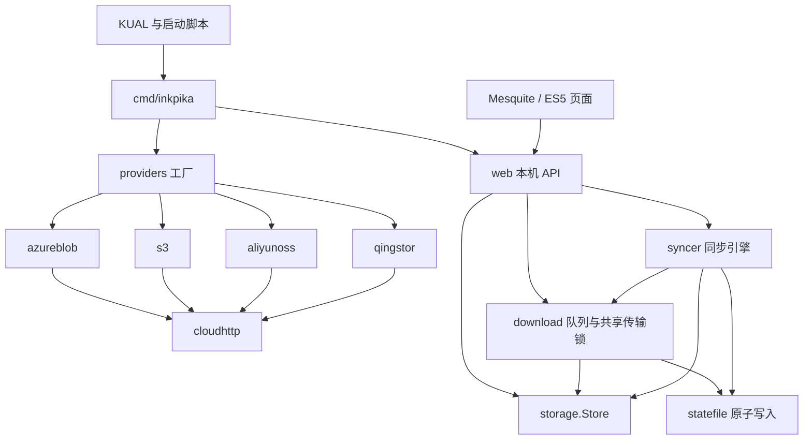

# InkPika开发文档

本文描述InkPika 0.0.1.dev的源码架构。安装与使用见 [README](../README.md)，开发环境、构建与 SSH 真机调试见 [README_DEV.md](../README_DEV.md)，配置与状态规则见 [兼容约定](COMPATIBILITY.md)，本版本验证范围见 [设备验证](DEVICE_VALIDATION.md)。

## 运行边界

产品面向各代 Kindle，当前安装要求已越狱并安装 KUAL；工程基线为日版 PW2，固件 5.12.2.2 / Linux 3.0.35。具体构建验证范围见 [设备验证](DEVICE_VALIDATION.md)。其他机型的已有兼容措施、待办与证据见[设备兼容性与适配记录](DEVICE_COMPATIBILITY.md)。Go 后台直接从 OSS、QingStor、Azure Blob 或 S3 兼容存储下载电子书到 Kindle，也接收手机 / 电脑无线传书；文件保存并索引后由 Kindle 原生阅读器打开。项目不提供云端写操作、格式转换、DRM 处理或独立阅读器。

后台以 Go 标准库实现，另用固定版本的纯 Go QR 编码库生成离线二维码。HTML/CSS/ES5 通过 `go:embed` 内嵌。界面运行在 Kindle Mesquite/WebKit 的独立 WAF 应用窗口；WAF 指设备的 Web 应用框架。离开窗口不会停止服务；“后台服务管理”分别控制云端书架、无线传书和配置设置。

## 模块与依赖方向



| 目录 | 职责 |
| --- | --- |
| `cmd/inkpika` | 参数、配置加载、进程锁、回环监听、会话文件、退出处理；`-sync` 调用本机 API |
| `cmd/preview` | 合成数据的电脑预览，不进入设备安装包 |
| `internal/config` | JSON 加载、公共校验、状态隔离；`providers.go` 放平台规则，`config.go` 定义默认值与来源标识 |
| `internal/providers` | 唯一的平台工厂；子包 `aliyunoss`、`qingstor`、`s3`、`azureblob` 实现对应签名与只读 API |
| `internal/storage` | `Object`、`Listing`、只读 `Store` 接口 |
| `internal/cloudhttp` | TLS 1.2+、内置 / 附加 CA、超时、显式 SOCKS5 代理；禁用环境代理和重定向 |
| `internal/download` | 串行续传队列、对象标识、文件名、已下载检查、共享传输锁 |
| `internal/syncer` | `sync/` 扫描、版本与内容校验、同步记录和动态 KUAL 菜单 |
| `internal/diagnostics` | 有时限的 HTTPS、Bucket 列举和文件抽样读取检查；脱敏结果 |
| `internal/statefile` | 同目录临时文件、flush/close 后原子替换、失败清理临时文件 |
| `internal/web` | Host/Token/Origin 校验、本机 JSON API、内嵌页面 |
| `internal/transfer` | 局域网上传/下载、配对认证、共享连接页和离线二维码 |
| `internal/settings` | 独立配对配置编辑器、字段白名单、原子保存和重启钩子 |
| `internal/bookformat` | 可配置电子书扩展名规则，供全部入口共用 |
| `internal/buildinfo` | 单一 `VERSION`，供 CLI、API 和打包脚本使用 |
| `extensions/inkpika` | KUAL 菜单、POSIX 脚本、配置示例、WAF 窗口引导；XML 版本为构建占位符 |

业务模块通过接口使用存储，不导入具体平台适配器。下载使用只包含 HEAD/GET 的小接口；浏览与同步使用完整 `storage.Store`。当前接口返回 `http.Response`，调用者负责关闭 Body。同步需要读取各平台的版本号及自定义元数据头；增加平台时也要检查这部分映射，不能只添加工厂分支。

## 启动、退出与本机协议

`service.sh` 检查配置并调用 `-state-dir`，确认 PID 对应本扩展二进制后复用或启动后台；`service.sh status` 只检查进程。默认不自动启动，只有明确开启后台、开始同步或打开云端书架时按需启动。后台持有 `server.lock`，监听 `127.0.0.1:8787`，加载下载/同步状态，生成随机 32 字节会话令牌，将 PID 和带 fragment 令牌的地址写入当前状态目录。

`start.sh` 在服务启动后验证会话 URL，通过 `register-ui.sh` 注册 `com.inkpika.app`，生成 `ui/launch.js` 并打开 Mesquite。安装路径固定为 `/mnt/us/extensions/inkpika`。独立应用申请 `local-port-access`；普通系统浏览器在本固件上不能替代这个入口。注册脚本只操作自身 app ID，遇到已有不同 command 时拒绝覆盖；指向其他路径的开发安装必须先注销。

`sync.sh` 调用本机 `-sync refresh|scan|start|cancel`，不打开窗口。`refresh` 在空闲时扫描，在已有任务运行时只发布当前状态；后台关闭时改用 `-scan-once`，持有相同 `server.lock` 检查后退出，不监听端口。令牌从文件读取，不放入命令行。`-sync status` 可用于诊断，CLI 流式输出完整 JSON。`stop.sh` 检查 `/proc/PID/exe` 后发送 SIGTERM；后台取消任务、等待文件操作结束、释放锁并清理 PID/会话文件。休眠、电源管理与系统索引行为保持由设备管理。

`menu.sh refresh` 使用 `-menu-action refresh` 读取配置与已保存状态，不启动后台。菜单写入者使用 `menu.json.lock` 串行生成，并在持锁后读取最新状态，避免服务状态与同步进度互相覆盖。服务启停后重建菜单；KUAL 原生 `if` 表达式在刷新时检查固定 PID 的 `/proc/PID/cmdline`，避免异常退出或重启后仍显示停止按钮。

云端书架保留兼容用的本机 `GET /api/config` 返回当前 `version`、UTC `packaged_at` 与明确白名单：provider、bucket、download_dir、同步范围，以及服务端已脱敏的 AccessKey ID / Secret。密钥只保留首尾各 2 个字符，不足 5 个字符全部隐藏；完整凭据与 SecurityToken 不进入浏览器。该页展示后台当前加载的配置，手工修改文件后需重启后台。

`POST /api/connection-check` 显式发起测试，`GET` 只读取上次结果。`internal/diagnostics.Run` 与保留兼容的 `menu.sh check` CLI 共用 `connection-check.lock`，并发请求返回 409；使用请求上下文和 35 秒总时限。先用无凭据 HEAD 验证 DNS/TCP/TLS，再签名列举当前 prefix，最多找 32 页以抽样读取一个对象的 1 字节，立即关闭响应，不创建图书或下载任务。结果脱敏保存至当前来源的 `connection-check.json`；读取按锁状态识别中断、排除其他来源，API 不返回内部 source 标识。空范围、分页循环、未找到样本都不能宣称文件读取成功。前端显示时间、三个阶段及完整错误，只有用户点击才发起测试，不自动轮询。KUAL 的“配置设置 [web]”默认显示已保存的配置、脱敏密钥、版本和打包时间，以及手动连通性测试。“手机 / 电脑”页签显示独立配对入口。云端书架仅保留书库和下载页签。配置设置的回环 GET /api/config 复用编辑器的字段白名单，GET / POST /api/connection-check 使用磁盘中的已保存配置和同一诊断锁；无需启动云端书架服务。缺少有效云端配置时仍可查看与配对，测试明确提示先完成配置。


API 认证头为 `X-InkPika-Token`。服务接受配置的回环 Host 或等价 `localhost`，POST 的 Origin 若存在必须匹配当前 Host。JSON 请求限制 16 KiB，拒绝多对象和未知字段。无参数的 `/api/jobs/clear` 也需提交 `{}`，同步接口可用空请求体。完整凭据不返回给前端。错误统一返回 `{"error":"说明"}`。

| 方法与路径 | 用途 |
| --- | --- |
| `GET /api/info` | 平台标签、空间及版本 |
| `GET /api/config` | 当前运行配置白名单、服务端脱敏密钥 |
| `GET /api/connection-check` | 上次测试结果，不发起云端请求 |
| `POST /api/connection-check` | 空对象 `{}`，执行有时限且互斥的连通性测试 |
| `GET /api/objects?prefix=…&marker=…` | 云端分页目录、格式与本地副本标记 |
| `GET /api/jobs` | 下载队列快照及当前本地文件状态 |
| `POST /api/download` | 提交对象键 `{ "key": "…" }` |
| `POST /api/jobs/action` | 任务操作 `{ "id": "…", "action": "retry" 或 "cancel" }` |
| `POST /api/jobs/clear` | 清理已结束的下载记录 |
| `GET /api/sync/status` | 同步快照 |
| `POST /api/sync/refresh` | 空闲时检查，运行时刷新当前进度 |
| `POST /api/sync/scan` | 仅检查远端与本地 |
| `POST /api/sync/start` | 检查并下载不一致项 |
| `POST /api/sync/cancel` | 取消同步 |

## 无线传书服务

`-transfer` 在加载云端配置前分流；读取可选 `transfer.json`，未配置也可启动。默认绑定 IPv4 `0.0.0.0:8789` 提供手机/电脑图书传入和导出，以及 `127.0.0.1:8790` 提供 Kindle 连接页。后者使用独立随机令牌，不复用上传会话。手机端仅接受本机网卡当前私有 IPv4 的 Host；不会把云端 API 暴露到局域网。

PW2 的 INPUT 默认 DROP。服务启动时通过 `/usr/sbin/iptables` 创建自己的 `INKPIKA_TRANSFER` 链和 `wlan0` 跳转，仅接受 RFC1918 源地址到传书 TCP 端口的流量；不修改默认策略或其他规则。正常停止及启动失败时撤销，异常终止遗留的自有链在下次启动时重建。未安装 iptables 的开发主机不执行此步骤。

`transfer-service.sh` 启动服务；`transfer-start.sh` 还通过 `open-ui.sh` 打开连接页。云端书架也使用 `open-ui.sh`，三个网页入口共用既有 `com.inkpika.app`，不会注册额外应用。`ui/service` 记录当前页面所属服务，停止另一服务时保留当前窗口。进程、锁和会话文件放在扩展目录 `transfer-state/`；服务启停刷新同一个 KUAL 菜单，即使云端配置缺失，仍显示无线传书控制。

本机 `GET /api/connection` 返回当前网卡地址、端口、Wi-Fi 名称、六位连接码和本地生成的 PNG 二维码。Wi-Fi 名称只通过只读 `currentEssid` 查询当前连接，不查询保存的网络配置。二维码携带 `#code=`，手机页自动提交连接码并清除 fragment；手动访问需输入连接码。`POST /api/pair` 限制每分钟最多十次失败尝试，成功返回随机会话令牌并设置 HttpOnly / SameSite=Strict Cookie。LAN 图书 API 需要此令牌或配对 Cookie；写操作校验 Origin。二维码和云端凭据不会交给外部服务。

上传为原始请求体，`X-File-Name` 使用百分号编码，按文件流式接收且全局仅一条上传流；每批最多选择 50 本，前端依次提交。校验扩展名、文件名、声明和实际大小、空文件、剩余空间及中断。隐藏临时文件与目标目录同盘，完成后原子 rename；同名（含符号链接）使用编号另存。默认目录为 `/mnt/us/documents/InkPika/Wireless`，云端命名、同步 receipts 与下载记录不变；上传记录仅展示于本次浏览器页面。服务锁保护并发实例，重启清理自己的遗留临时文件。

本地图书 `GET /api/books` 递归扫描 documents，以统一格式过滤，支持文件名搜索和 50 项分页，排除隐藏文件、符号链接与 `.sdr` 目录。`POST /api/export` 校验 1–50 个不透明文件 ID，生成两分钟有效的一次性下载票据；`GET /api/download` 还需配对 Cookie 或会话头。下载前重新核对格式和文件身份，单本附件、多本流式无压缩 ZIP，不生成临时压缩副本。

## 配置设置与共享格式

`internal/bookformat` 定义默认格式、扩展名规范化与允许规则；`ebook_formats` 未指定或为空时回退内置格式。云端配置加载后供下载队列、目录及 `sync/` 扫描共同使用。无线传书在每次操作时从共享配置仅读取格式列表，账号缺失也可使用；非法显式规则失败，不扩大默认范围。

`internal/settings` 在独立配对会话中提供配置 GET/POST。`-settings` 使用 LAN 8791、回环 8792 和 `settings-state/`；不提供图书下载 API。浏览器只收到字段白名单和脱敏密钥，空密钥输入保留原值。保存通过 revision 防止覆盖并发编辑，通过配置锁、临时校验文件及原子替换写入；旧配置备份为 `config.json.previous`。更换来源时清除显式旧 state_dir，让来源隔离生效。云端正在运行时先安全停止，写入后恢复运行状态；停止失败不写配置，重启失败明确报告。

`transfer.NewPortal` 只复用配对、Host/Origin、静态资源和 Kindle 引导页，各服务注入独立 API handler 和端口会话。配置设置另注入 DeviceAssets / DeviceAPI，仅在回环端口通过 Host、独立令牌和 POST Origin 校验后可访问；配置写入仍仅允许已配对的 LAN 会话，连通性测试不暴露至 LAN。配置设置使用自己的 `INKPIKA_SETTINGS` 防火墙链；停止一项服务不会撤销另一项规则。

## 配置与持久化兼容

`provider` 为 `aliyun_oss`、`qingstor`、`s3` 或 `azure_blob`。配置加载器、工厂和调用代码必须明确选择平台，省略或未知值直接失败。OSS 使用 V4 签名和 ListObjectsV2，region 必填，可携带 STS；QingStor 使用原生 QS 签名，也接受供应商配置字段 `zone`。

默认状态目录按平台与来源隔离；来源标识包含 Endpoint/Bucket，OSS / S3 还包括 provider/region，排除凭据、SOCKS5 代理、附加 CA、S3 预设和访问方式，因此同一 Endpoint/Bucket/region 下轮换密钥或更改连接方式不改变记录。QingStor 来源以 Endpoint/Bucket 标识；后续更改身份规则需设计数据转换。

| 数据 | 位置与约定 |
| --- | --- |
| 下载记录 | `state_dir/jobs.json`；重启后未完成任务暂停，等待手动继续 |
| 同步记录 | `state_dir/sync.json`；来源、元数据、SHA-256 receipts、最近快照；重启标记缓存 |
| 未完成图书 | `state_dir/parts/`；浏览器 `.part` 可续传，同步临时文件从头重试 |
| 运行文件 | `server.lock`、`server.pid`、`launch.url`、有界轮换日志 |
| 完整图书 | `download_dir/`，原文件名附加来源/对象标识短码 |

图书与状态必须位于同一文件系统，保证最终 rename。`statefile.Write` 不更改 JSON 格式，也不创建父目录；调用方管理目录和逻辑更新锁。原子替换防止读到半写文件，不承诺 FAT 在突然断电时绝对不会丢失数据。

下载历史额外保存可选 `transfer_complete`，省略此字段的 completed 记录按已完成传输解释；API 每次读取重新检查目标是否存在、为普通文件且大小一致，派生 `local_state`，不修改既有 status/ID/命名。界面区分传输完成、已保存、本地移除和本地变化。

## S3 与代理传输

`internal/providers/s3` 使用标准库实现 AWS Signature V4、ListObjects / ListObjectsV2、HeadObject 和 GetObject。签名不清理对象路径、不二次 URI 编码；查询按编码后的键和值排序。列举请求使用 `encoding-type=url`，仅解码对象键与目录，不解码 continuation token。分页标记缺失或停滞失败，错误响应及时关闭 Body，不回显上游 Code/Message 或签名材料。GET 传递 Range、If-Match，沿用下载管理器的响应与大小校验。同步识别 `x-amz-version-id`、`x-amz-meta-*` 和显式 MD5 元数据，ETag 始终不是校验和。

`config/providers.go` 负责 `s3_preset=aws|r2|b2|spaces|tos|ibm|gcs|cos|custom`、地域、默认 Endpoint、`s3_addressing=path|virtual` 规则。工厂只选择协议适配器，业务模块不识别云厂商。R2 region 为 `auto`；自定义服务默认 `us-east-1`；R2 / 自定义 Endpoint 必填。带点 Bucket 和 IP Endpoint 不使用虚拟主机模式，避免 TLS 主机名不匹配。

配置页面用一个“存储平台”选择器列出 OSS、QingStor、Azure Blob 和九种 S3 平台。页面读取和保存时将 S3 选项映射到既有的 `provider=s3` 与 `s3_preset`；未指定预设的 S3 配置按 `custom` 回显，API 和磁盘配置格式保持不变。

火山 TOS、Google Cloud Storage、腾讯 COS 使用 ListObjects V1：请求传入 marker，仅在响应声明 `encoding-type=url` 时解码对象键和 NextMarker；缺失 NextMarker 时使用最后对象键，不能取得或重复标记时失败。IBM 使用 V2，不解码不透明 continuation token。TOS / COS 必须 virtual，COS Bucket 包含 APPID；IBM / GCS 使用 HMAC 密钥、不接受临时令牌。GCS 默认 region 为 auto，仅接受 3–63 位 DNS 风格 Bucket。同步识别这些平台的版本号、自定义元数据与显式 MD5，GCS metageneration 也参与比较。

`internal/providers/azureblob` 实现 Azure Blob Shared Key / HMAC-SHA256 和 2021-12-02 API：List Blobs、HEAD、带 Range / If-Match 的 GET。账户名、64 字节 Base64 账户密钥对应现有配置的 access_key_id / secret_access_key；bucket 对应容器，region 归一为空。支持显式主权云 Endpoint，不支持 SAS / Entra。客户端不写云端，但账户密钥并非只读授权。列表保留不透明 NextMarker，按 Name 的 Encoded 属性解码；错误响应关闭 Body，不回显上游消息。网络仍由 cloudhttp 管理。账户密钥轮换保留来源标识；更换账户时，配置页保存会重算自动派生的 Endpoint。

`cloudhttp.New(config.Config)` 返回 client/error，使用 Go 1.23 标准库的 SOCKS5 实现，无第三方运行时依赖。`socks5_proxy` 只接受显式端口的 socks5/socks5h URL，可使用 RFC 1929 认证；两种 scheme 均将目标域名交给代理。TCP/SOCKS 握手遵循超时和上下文取消；代理失败不直连。未配置时直接连接，始终忽略环境代理；HTTPS 仍校验证书和主机名，拒绝所有重定向。`ca_bundle` 是额外 PEM CA 文件绝对路径（普通文件，最多 1 MiB），在内置根证书上追加，不提供 insecure 开关。

配置门户 GET 只返回 `socks5_proxy_set`，POST 空字符串保留代理、`clear_socks5_proxy=true` 清除；更换 S3 预设需要新密钥并清除未重新提供的临时令牌。保存前解析本地 CA，不发起网络请求。云端配置 API 只展示连接方式，不返回代理地址、用户名或密码。诊断使用同一网络设置并脱敏代理 URL 与凭据。无线传书、配置服务和本机控制请求使用原网络路径。

仓库包含第三方 gofakes3 内存服务用例，用于验证五个 S3 预设的读取、分页、5 MB 断点续传和递归同步；mock 选型、版本与限制见 [README_DEV](../README_DEV.md#内存-s3-集成测试)。独立协议夹具覆盖 AWS 示例签名、特殊对象键、不透明分页、续传、错误关闭、重定向、S3 版本变化、SOCKS5 远端 DNS / 认证 / 取消 / 失败不回退、私有 CA 与证书主机名、配置保存和脱敏。不代表真实 AWS/R2/B2/Spaces、NAS 或 Kindle 联调已完成。

## 下载与同步约束

浏览器队列串行工作；`download.Manager.WithTransfer` 进一步串行化队列与整个同步任务的检查/写入。默认允许 AZW/AZW3/MOBI/PRC/PDF/TXT，通过 `ebook_formats` 统一调整。EPUB 等格式即使允许传送，也不会因此获得原生阅读支持。

浏览器下载检查大小、ETag/If-Match、Content-Range；服务端忽略 Range 时重头下载，不能拼接完整响应。ETag 仅作版本标识。60 秒无新数据会结束当前尝试，保留续传数据；完整文件才进入图书目录，不能覆盖已有文件。

同步只处理根目录 `sync/`，遵守配置 prefix，递归目录与不透明分页标记，拒绝分页循环，限制扫描 20000 项。完整扫描成功才发布远端集合；失败保留旧快照并标记缓存，不能把失败当成空目录。快照包含 `books` 完整清单，每项含 `status`；`unfinished` 保存完整的未完成列表。所有书籍按修改时间倒序、同时间按对象键排序，交给 KUAL 原生分页。记录缺少完整清单时要求刷新，不从 receipts 推造远端集合。图形界面使用目录 API 和手工下载队列。

每个对象通过 HEAD 比较大小、ETag、Last-Modified、版本及自定义元数据，并计算本地 SHA-256。显式 Content-MD5 或平台 MD5 元数据支持十六进制/Base64；相互冲突时失败。没有稳定远端版本时重新下载核对。下载后再次 HEAD 复核版本，成功才原子替换已登记副本。不同的未登记本地副本不覆盖，远端删除不删除本地书。

KUAL 动态菜单只生成固定 shell action/params。远端名称和错误只进入 JSON 标签。内部 status 固定 ASCII，避免 KUAL awk 字节长度与 Java 字符长度不一致；显示标签可中文。导航项不设置 `refresh: true`，避免进入子菜单后因 KUAL 重载退回顶层；仅状态／同步及服务操作请求刷新。状态刷新手动触发，后台不会抢占窗口。

## 构建与验证

```sh
sh scripts/check.sh
sh scripts/build.sh
GOTOOLCHAIN=go1.23.12 go run ./cmd/preview -provider aliyun_oss
```

`.go-version` 固定 Go 1.23.12，ARM 参数为 `CGO_ENABLED=0 GOOS=linux GOARCH=arm GOARM=5`。更高版本 Go 的内核要求不适合 PW2；这也是当前安全维护限制。

`check.sh` 验证格式、Go race tests/vet、shell 语法及 Python 打包回归测试，排除忽略目录的临时代码。CI 执行相同命令并上传 ZIP 与 SHA-256；不会自动发布 GitHub Release。

`scripts/build.sh` 在独立临时目录编译；`package.py` 只读取明确白名单，从 `internal/buildinfo/VERSION` 渲染 XML，校验 ARM ELF 头，固定 ZIP 时间戳和 Unix 权限，生成 checksum。相同源码、工具链和 Python/zlib 环境下输出可复现；不承诺不同压缩库版本的 ZIP 字节完全相同。源码 XML 的 `@VERSION@` 不是最终发行元数据，设备请安装构建产物。

自动测试不需要账号或设备，覆盖协议签名、分页、异常响应、下载续传、同步完整性、共享锁、认证与状态兼容。实际执行的检查和验证范围见 [DEVICE_VALIDATION.md](DEVICE_VALIDATION.md)。

## 增加存储平台

1. 在 `internal/providers/<name>/` 实现 `storage.Store`，处理签名、路径编码、分页、HEAD、Range、If-Match 和错误脱敏。关闭或交付每个 response body。
2. 在配置模块增加平台常量、显示标签、验证和 Endpoint 推导，明确不会碰撞旧来源的 identity 规则；在 `providers.New` 注册。
3. 复用 `cloudhttp` 的 TLS 和重定向策略。检查同步元数据读取是否需要适配，不改变已有 receipt 的字段表示。
4. 增加平台协议测试、配置示例、文档及打包白名单，再验证真实 Bucket。

若未来接入 OAuth 网盘，需要另行设计凭据刷新与临时链接生命周期。新 UI 可以继续调用本机 API，但仍需设备上的窗口、会话和输入适配；现有版本不包含 KOReader、FBInk 或 LVGL 集成。

## Localization

`internal/i18n` owns English/Chinese resolution and rendering. Device interfaces share `config.json.language`; LAN visitors cannot change that preference through request headers. Language-only saves work without cloud credentials. The public website and root README default to English. See [Localization](LOCALIZATION.md) for catalogs, fallback, state compatibility and preview generation.
